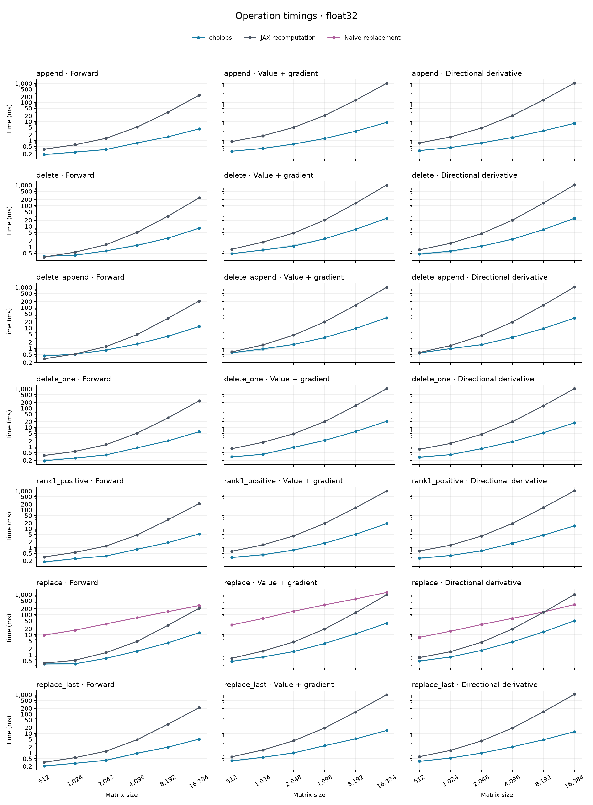
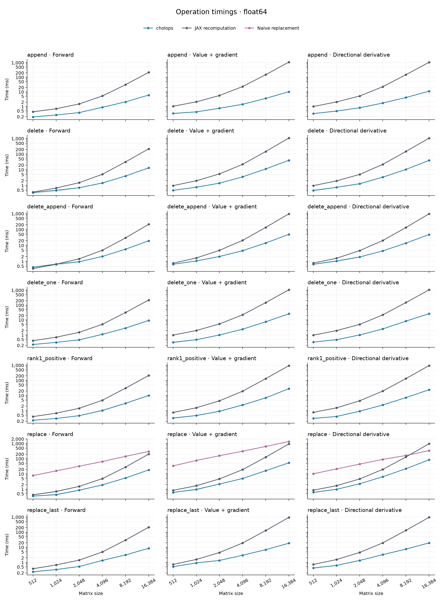

# Benchmarks

This page presents H100 results for cholops 0.2.1. The seven main operations are
append, general deletion, single-variable deletion, positive rank-one update,
replacement, delete-and-append, and trailing-block replacement. Each is measured
in float32 and float64, in forward, reverse and JVP modes, at matrix sizes
512–16,384.

All seven operations were faster than dense JAX recomputation at size 16,384.
Forward delete-and-append was slower at size 512 in both precisions.
Forward deletion was also slower at 512 in float32.
The plots show the full range, and the tables give absolute times at
**16,384 × 16,384**.

## What the timings include

Every operation starts from an existing Cholesky factor. The JAX baseline
reconstructs `L @ L.T`, applies the change and factors the resulting covariance.
Replacement also includes a naive baseline using two signed rank-one JAX scans
with standard autodiff. See [_recompute.py](_recompute.py), [_naive.py](_naive.py)
and the operation references in [workloads.py](workloads.py).

**Forward** returns the updated factor. **Value + gradient** evaluates a fixed
weighted sum of that factor and differentiates it with respect to every
continuous input. Both the primal calculation and reverse pass are timed.
**Directional derivative (JVP)** evaluates the factor and its derivative along
one input direction.
Indexed operations modify the first variable. Trailing-block replacement
changes four variables.
Both deletion benchmarks remove one variable. `chol_delete_one` uses the
specialized rank-one kernel and is faster than `chol_delete` across the measured
sizes and modes.

These are warm execution times. Each point is the median of three process
medians, and shading spans their minimum and maximum. Compilation and cold
first use are recorded separately in [summary.csv](summary.csv).
[Speedups](speedups.csv) are calculated within each process before taking their
median.

## Float32 results



At **16,384**, times in milliseconds:

| Operation | Forward cholops / JAX (ms) | Value + gradient cholops / JAX (ms) |
| --- | ---: | ---: |
| `chol_append` | 4.10 / 239.80 | 9.07 / 1017.39 |
| `chol_delete` | 8.12 / 241.17 | 24.82 / 1016.83 |
| `chol_delete_one` | 6.05 / 239.22 | 21.03 / 1023.25 |
| `chol_rank1_positive` | 5.26 / 213.15 | 18.73 / 1007.18 |
| `chol_replace` | 12.60 / 209.50 | 37.95 / 984.80 |
| `chol_delete_append` | 11.82 / 212.49 | 32.07 / 1007.55 |
| `chol_replace_last` | 5.10 / 213.21 | 14.23 / 1000.42 |

## Float64 results



At **16,384**, times in milliseconds:

| Operation | Forward cholops / JAX (ms) | Value + gradient cholops / JAX (ms) |
| --- | ---: | ---: |
| `chol_append` | 6.04 / 219.36 | 10.24 / 1104.34 |
| `chol_delete` | 13.26 / 222.20 | 40.29 / 1086.97 |
| `chol_delete_one` | 8.96 / 222.35 | 25.66 / 1087.73 |
| `chol_rank1_positive` | 10.04 / 214.26 | 28.19 / 970.46 |
| `chol_replace` | 17.99 / 201.96 | 53.13 / 956.45 |
| `chol_delete_append` | 19.87 / 216.32 | 48.88 / 993.27 |
| `chol_replace_last` | 8.52 / 214.05 | 18.47 / 965.57 |

The two tables compare cholops with dense recomputation. For single-variable
replacement, the plots also show the naive baseline. At 16,384, its forward and
value-plus-gradient times are 287.45 / 1291.14 ms in float32 and
321.28 / 1414.57 ms in float64. The compact [summary](summary.csv) contains all
sizes, modes and implementations.

A caller that already stores its covariance can avoid reconstructing `L @ L.T`.
These factor-input timings therefore describe individual operations, rather
than a complete GP calculation. The campaign also provides sequence benchmarks
whose recomputation baseline retains the covariance between steps.

## Memory

Faster execution does not always mean lower memory use. The following compiler
working-set estimates are for **float64 at 16,384**:

| Operation | Forward cholops / JAX (GiB) | Value + gradient cholops / JAX (GiB) |
| --- | ---: | ---: |
| `chol_append` | 4.00 / 8.00 | 6.00 / 12.00 |
| `chol_delete` | 8.00 / 8.00 | 12.52 / 12.03 |
| `chol_delete_one` | 6.13 / 8.00 | 10.14 / 12.03 |
| `chol_rank1_positive` | 4.13 / 8.00 | 14.14 / 10.03 |
| `chol_replace` | 8.13 / 8.00 | 14.25 / 14.50 |
| `chol_delete_append` | 8.00 / 6.03 | 12.50 / 16.50 |
| `chol_replace_last` | 4.00 / 8.00 | 6.00 / 12.00 |

The working set is arguments + outputs + temporaries - aliases. These are
compiler estimates, not measured peak GPU allocations. Values are the largest
estimate across process repeats. [summary.csv](summary.csv) includes both
precisions and separates temporary storage from the whole working set. The
[replacement memory plot](figures/memory.svg) also includes the naive baseline.

## Numerical accuracy

Numerical differences are recorded alongside timings without filtering samples
or changing outputs. The [numerical tests](../TESTING.md) check factors and
gradients on specified fixtures.

In the 0.1.0 campaign, one float32 delete-and-append case at 8,192 illustrated
why disagreement with recomputation needs interpretation. Its weighted scalar
loss differed by about 0.00071 relative. Promoting the same inputs and loss
weights to float64 showed that cancellation in the float32 baseline caused most
of the discrepancy:

| Relative error against the same-input float64 reference | cholops float32 | JAX float32 |
| --- | ---: | ---: |
| Factor | 1.31e-7 | 1.23e-5 |
| Weighted scalar value | 1.10e-5 | 6.99e-4 |
| Largest gradient-leaf error | 3.16e-7 | 1.71e-5 |

This is a diagnostic for that case. Accuracy requirements still depend on the
application and conditioning of its matrices.

## Reproduce the results

The recorded campaign used the same library and benchmark code as `v0.2.1`.
It ran on an NVIDIA H100 with
95,830 MiB reported memory, driver 615.71.09, 32 CPU threads per process,
JAX/JAXlib 0.11.2, NumPy 2.5.4 and Python 3.13.17.
Float32 and float64 ran in separate processes with matrix multiplication
precision set to `highest`. All 828 planned cases completed without skips.

### Run the campaign

From a checkout on a configured Linux GPU host:

```sh
uv sync --locked --all-groups --extra cuda13

# Write a plan to inspect before running measurements.
uv run --locked python -m benchmarks.suite --backend gpu \
  --memory-budget-gib 64 --output results/benchmarks/main-plan

# Create and execute a new plan on this host.
uv run --locked python -m benchmarks.suite --backend gpu \
  --memory-budget-gib 64 --output results/benchmarks/main --execute

# Generate figures and summary tables from that campaign.
uv run --locked python -m benchmarks.plot results/benchmarks/main \
  --output results/benchmarks/main/plots
```

The default plan contains 828 cases: 756 for seven operation curves and
72 for the additional workloads below. It uses six sizes, two precisions,
forward, reverse and JVP modes, and three process repeats. The seventh operation,
`chol_delete_one`, uses the same inputs as `chol_delete` to compare the specialized
single-variable path.
Output directories for plans and cases must be new. Use `--backend cpu` for a CPU
campaign and omit the CUDA extra when installing its environment. Select `--sizes`
and `--dtypes` for smaller runs.

Each case runs in a fresh process. After compilation and the first synchronized
call, every implementation receives two warmups and fifteen timed calls.
Implementation order is shuffled within each round and saved. Timing waits for
the entire output. Inputs are already on the device, and buffers are not donated.
The seed is fixed, using a dense Gram covariance from at most 16 features plus
an identity term. Process repeats measure timing variability on the same matrix.

Choose a memory budget below available device RAM. The runner checks memory
before preparing fixtures and before executing compiled code. Cases that exceed
the budget appear as explicit skips in `coverage.csv`. Execution errors stop the
campaign and leave a case log to inspect. Optional sizes 32,768 and 65,536 need
substantially more memory and are outside the default plan.

### Where results are stored

Raw campaigns belong in the gitignored **`results/benchmarks/`** directory at
the repository root. Each campaign contains its plan, case directories, logs,
timing samples, numerical diagnostics and source metadata.

The repository keeps the report in this README, selected figures in
[`figures/`](figures/), and the compact `summary.csv` and `speedups.csv` tables.
Raw measurements are not included in a fresh checkout. To regenerate plots,
run a campaign or use a retained local campaign as the input to `benchmarks.plot`.
New runs measure the current checkout and record its source hashes and
environment. The plotter checks that cases match the plan and use consistent
hardware and JAX versions. Combining source versions requires a source audit
for each case. Use `--allow-partial` to preview an incomplete campaign.

### Check the setup with one small case

```sh
uv run --locked python -m benchmarks.run --backend cpu --dtype float64 \
  --workload operations --operation replace --mode full_vjp \
  --implementations tensor naive recompute --n 8 --position first \
  --samples 3 --memory-budget-gib 4 --output results/benchmarks/smoke
```

This checks execution and output files. Use the declared campaign sizes for
performance comparisons. Add `--dump-hlo` when profiling an individual case.

## Additional workloads

The campaign also measures:

- Signed rank-one and diagonal updates at size 4,096, using weight `-0.2`.
  These compare tensor calls with dense recomputation.
- 16-step replacement sequences at sizes 2,048 and 8,192, comparing `Cholesky`,
  `PermutedCholesky` and dense recomputation. Each includes initialization and
  a Gaussian loss at every step. Recomputation retains the covariance between
  steps. All methods use four-step checkpoint blocks.

Both workloads use float32 and float64, forward, reverse and JVP modes, and
three process repeats, giving 36 cases each. Indexed updates start at the first
position. Sequences advance the index after each step. Reverse mode differentiates
the mean sequence loss with respect to initial features, incoming features and
scale. Their measurements are included in [summary.csv](summary.csv).

At size 4,096, both signed updates were slower than dense recomputation. In
float64, their forward times were 104.64–108.40 ms versus 4.95–4.99 ms for
recomputation. Value + gradient took 476.33–482.04 ms versus
18.87–19.03 ms.

## Code layout

`suite.py` defines and launches cases. `workloads.py` builds the computations and
reference results that `run.py` compiles and times. `plot.py` reads the saved
campaign and produces summaries and figures. `_support.py` supplies fixtures,
diagnostics and checkpointing. `_environment.py` records source and environment
information. The full pytest suite checks the workload calculations against
their references.
